
  

  

<!-- Insights & Skills design based on github.com/rladntlr (originally github.com/rdme0) -->
<a href="https://github.com/CoderGogh">
  <picture>
    <source media="(prefers-color-scheme: dark)" srcset="assets/github-metrics-dark.png">
    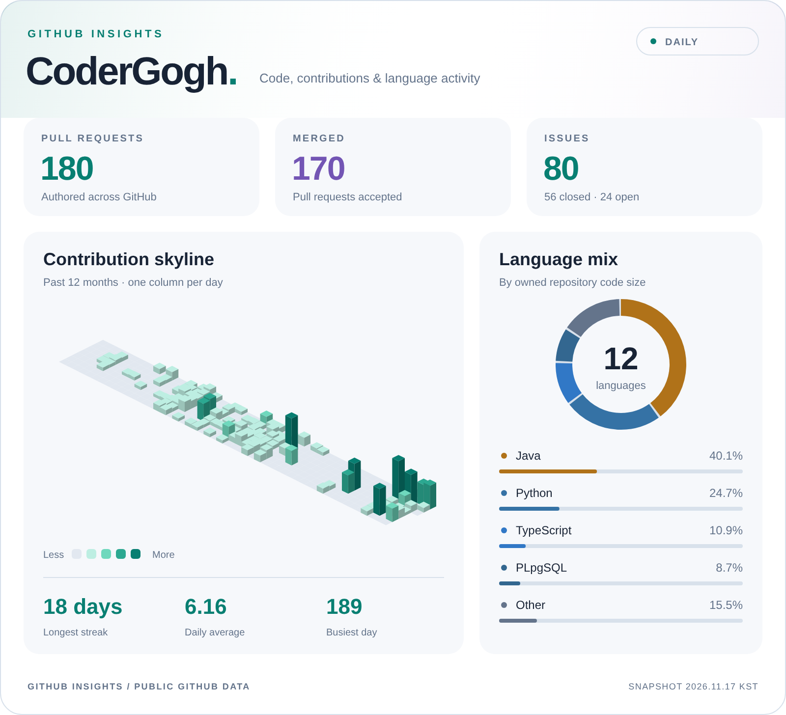
  </picture>
</a>

## 🛠️ Skills
<!-- Glass icons: scripts/render_skills.py --fetch --browser-channel chrome -->

### Languages

  <picture>
    <source media="(prefers-color-scheme: dark)" srcset="assets/skills/java-glass-dark.png">
    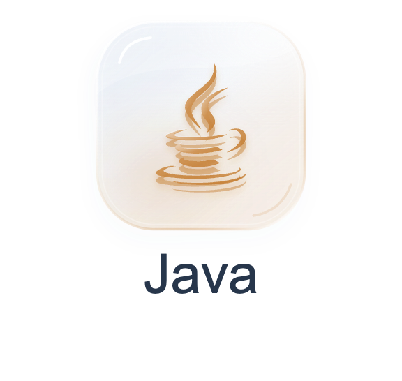
  </picture>
  <picture>
    <source media="(prefers-color-scheme: dark)" srcset="assets/skills/python-glass-dark.png">
    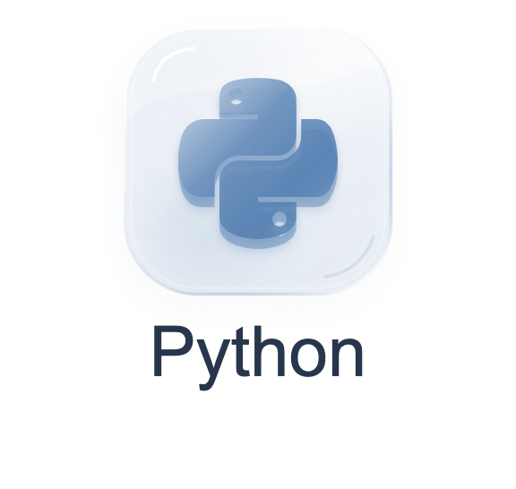
  </picture>

### Backend

  <picture>
    <source media="(prefers-color-scheme: dark)" srcset="assets/skills/springboot-glass-dark.png">
    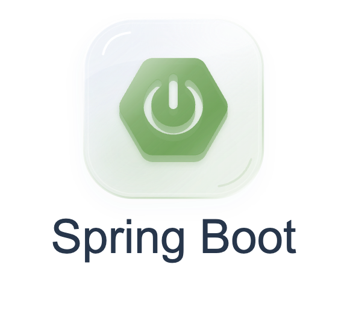
  </picture>
  <picture>
    <source media="(prefers-color-scheme: dark)" srcset="assets/skills/hibernate-glass-dark.png">
    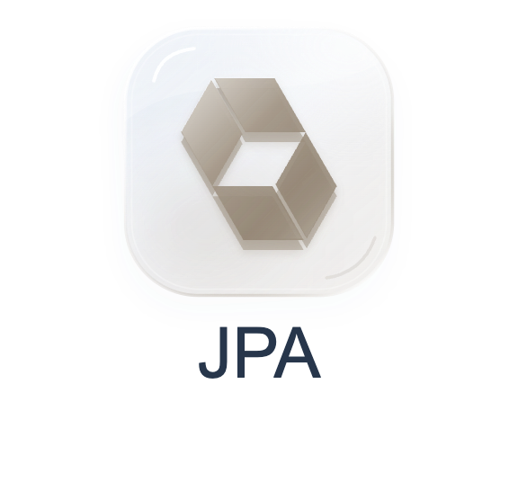
  </picture>
  <picture>
    <source media="(prefers-color-scheme: dark)" srcset="assets/skills/fastapi-glass-dark.png">
    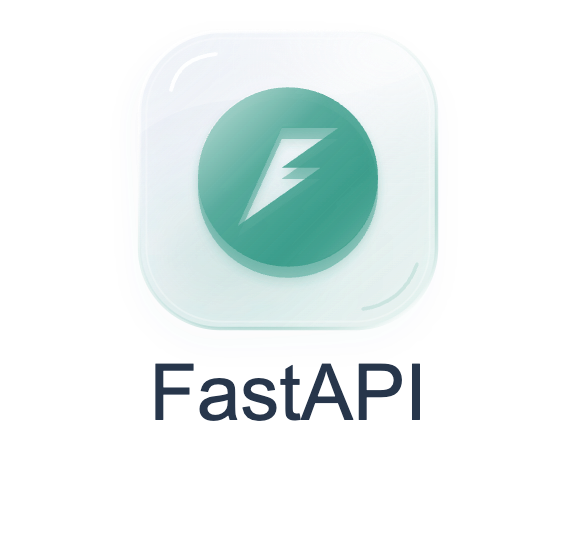
  </picture>

### DB & Messaging

  <picture>
    <source media="(prefers-color-scheme: dark)" srcset="assets/skills/mysql-glass-dark.png">
    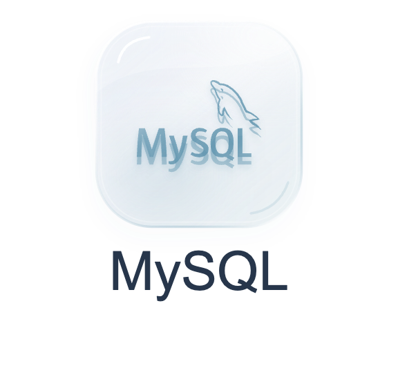
  </picture>
  <picture>
    <source media="(prefers-color-scheme: dark)" srcset="assets/skills/postgresql-glass-dark.png">
    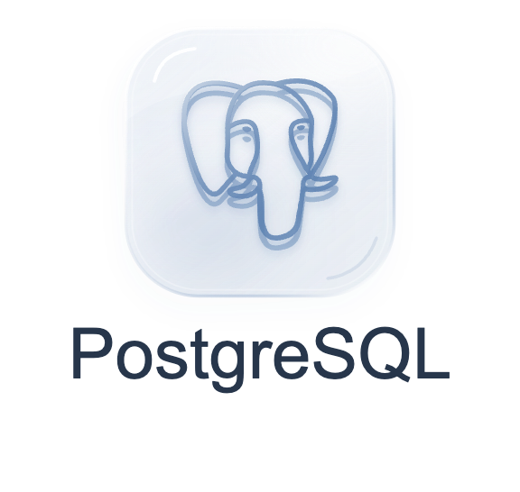
  </picture>
  <picture>
    <source media="(prefers-color-scheme: dark)" srcset="assets/skills/mongodb-glass-dark.png">
    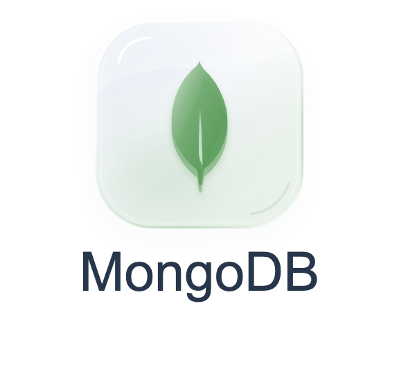
  </picture>
  <picture>
    <source media="(prefers-color-scheme: dark)" srcset="assets/skills/redis-glass-dark.png">
    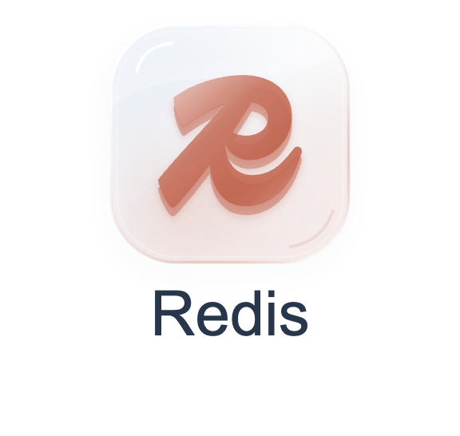
  </picture>
  <picture>
    <source media="(prefers-color-scheme: dark)" srcset="assets/skills/kafka-glass-dark.png">
    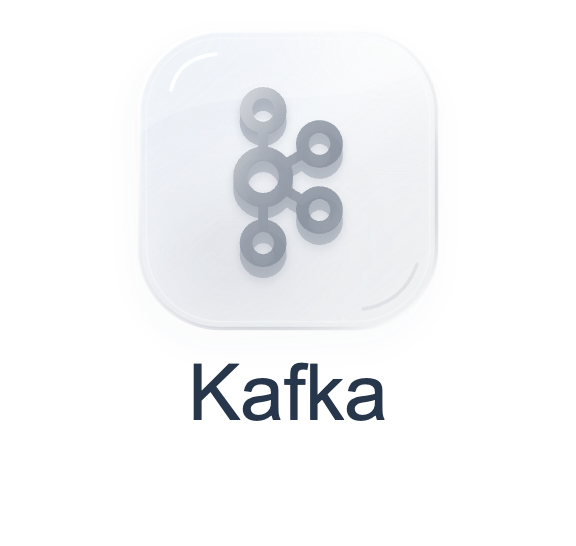
  </picture>

### AI & Search

  <picture>
    <source media="(prefers-color-scheme: dark)" srcset="assets/skills/elasticsearch-glass-dark.png">
    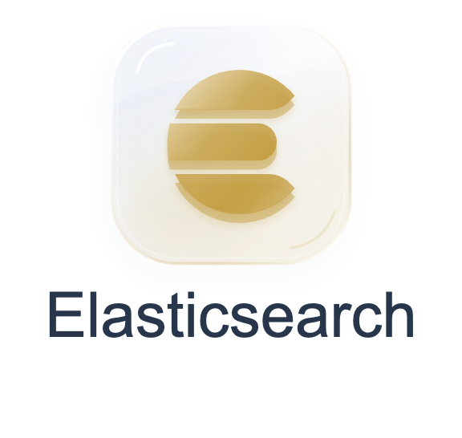
  </picture>
  <picture>
    <source media="(prefers-color-scheme: dark)" srcset="assets/skills/nori-glass-dark.png">
    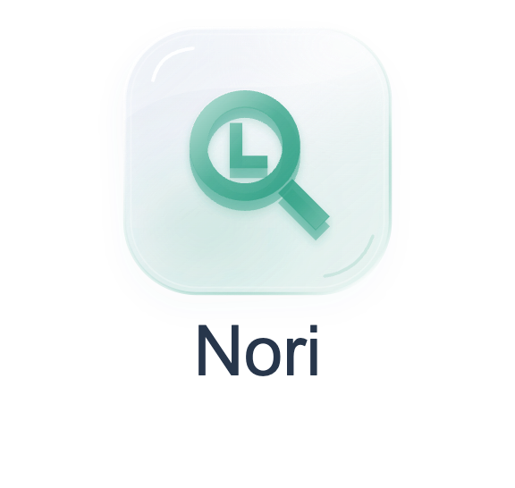
  </picture>
  <picture>
    <source media="(prefers-color-scheme: dark)" srcset="assets/skills/gemini-glass-dark.png">
    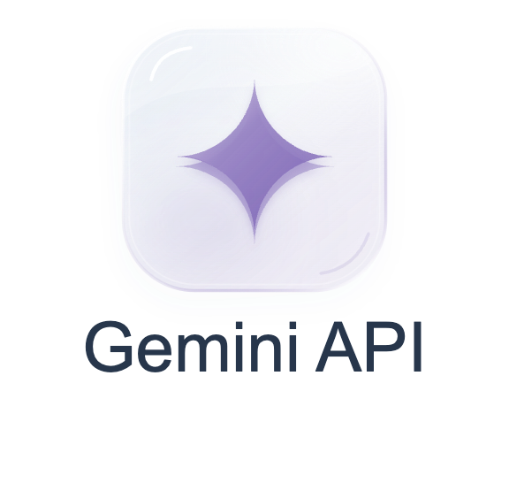
  </picture>

### Data Pipeline & Infra

  <picture>
    <source media="(prefers-color-scheme: dark)" srcset="assets/skills/airflow-glass-dark.png">
    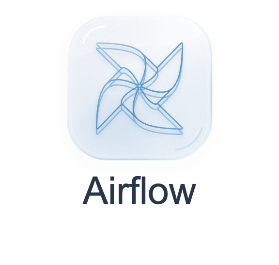
  </picture>
  <picture>
    <source media="(prefers-color-scheme: dark)" srcset="assets/skills/githubactions-glass-dark.png">
    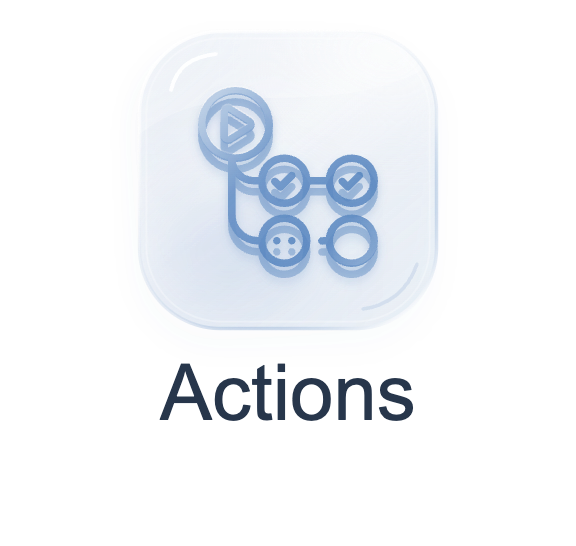
  </picture>
  <picture>
    <source media="(prefers-color-scheme: dark)" srcset="assets/skills/gitlab-glass-dark.png">
    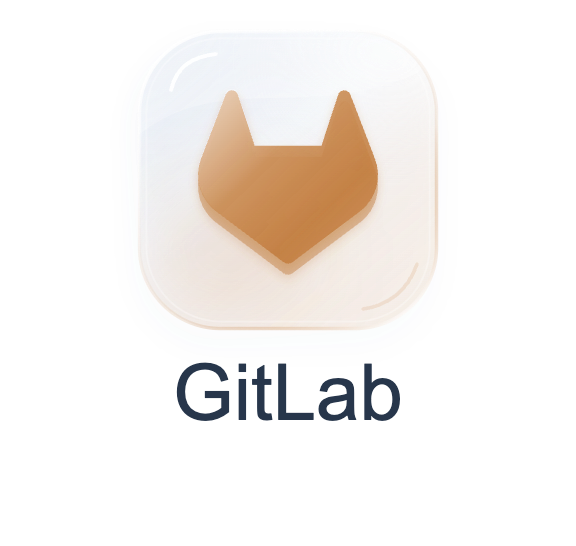
  </picture>
  <picture>
    <source media="(prefers-color-scheme: dark)" srcset="assets/skills/docker-glass-dark.png">
    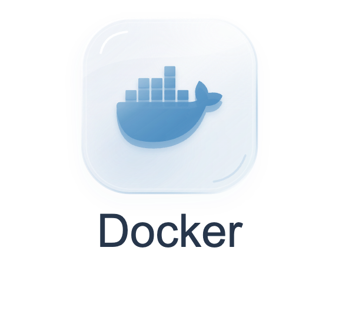
  </picture>
  <picture>
    <source media="(prefers-color-scheme: dark)" srcset="assets/skills/aws-glass-dark.png">
    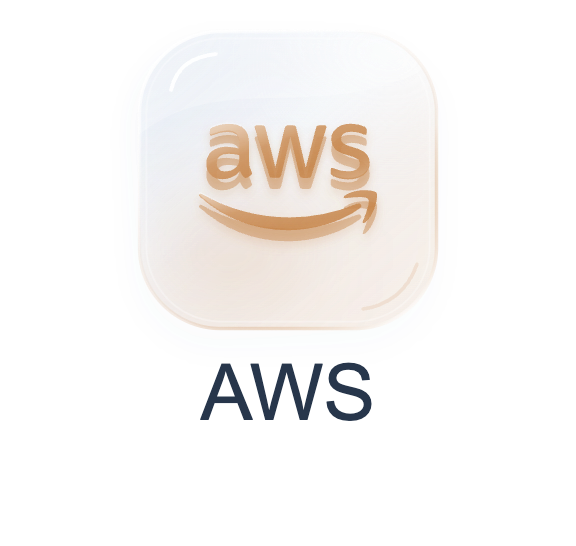
  </picture>

## 💾 Projects

<table>
  <tr>
    <td width="50%" valign="top">
      <h3>💸 <a href="https://github.com/CoderGogh/async-settlement-system">Async Settlement System</a></h3>
      
📦 <b>일 500만 건 통신요금 정산</b>

      
정산 배치와 알림 발송을 Kafka로 비동기 분리했습니다. 재처리 책임을 Producer로 옮겨 유실률 0%를 만들고, JPA→JDBC 전환과 Bulk Insert 튜닝으로 배치 시간을 48% 줄였습니다.

      
<code>Spring Batch</code> <code>Kafka</code> <code>MySQL</code>

      
<a href="https://async-settlement-system.vercel.app">🚀 deploy</a>

    </td>
    <td width="50%" valign="top">
      <h3>🎧 <a href="https://github.com/4Ureca">AI-based CRM</a></h3>
      
🤖 <b>Gemini 상담 요약·분류·품질평가</b>

      
카테고리별 프롬프트 분기와 모델 교체로 분류 정확도를 60%→85%로 올리고 비용을 80% 줄였습니다. Elasticsearch + Nori 튜닝으로 검색 속도를 80% 단축했습니다.

      
<code>Spring Boot</code> <code>Elasticsearch</code> <code>Gemini API</code>

      
<a href="https://aicc-crm.vercel.app">🚀 deploy</a>

    </td>
  </tr>
  <tr>
    <td width="50%" valign="top">
      <h3>⚡ <a href="https://github.com/CoderGogh/Eon-BackEnd-Server">EON</a></h3>
      
🏆 <b>정보통신기획평가원(IITP) 원장상</b>

      
전기차 보조금과 위치 기반 충전소 정보를 하나로 통합했습니다. PostGIS 반경 매핑과 Redis 계층형 캐싱으로 응답 지연을 100s에서 10ms대로 줄였습니다.

      
<code>FastAPI</code> <code>PostGIS</code> <code>Redis</code>

      
<a href="https://get-your-eon.vercel.app">🚀 deploy</a> · <a href="https://github.com/CoderGogh/Eon-FrontEnd-Server">frontend</a>

    </td>
    <td width="50%" valign="top">
      <h3>🗺️ <a href="https://github.com/CoderGogh/seoul-ev-data-platform">Seoul EV Siting Platform</a></h3>
      
🔁 <b>Airflow DAG 7개 데이터 파이프라인</b>

      
EV 등록현황과 실시간 도로소통정보를 주기별로 수집·정제해 행정동 단위로 결합하고, 충전소 우선 검토 지역을 선정합니다. 수집부터 품질 모니터링까지 직접 설계했습니다.

      
<code>Airflow</code> <code>PostGIS</code> <code>GitLab CI</code>

      
<a href="https://seoul-ev-insight.vercel.app">🚀 deploy</a>

    </td>
  </tr>
</table>

---

## GitHub Stats

<table align="center">
  <tr>
    <td align="center" style="border: none;">
      
    </td>
    <td align="center" style="border: none;">
      
    </td>
  </tr>
</table>

